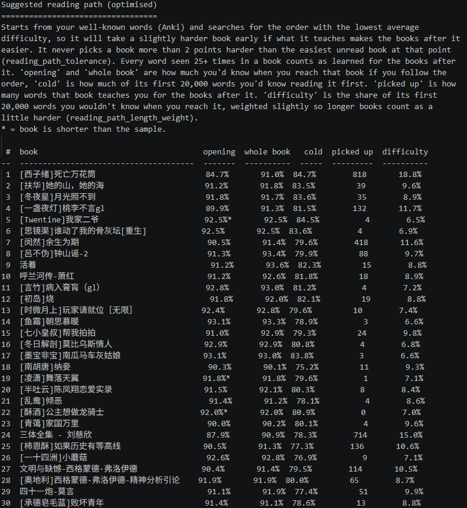
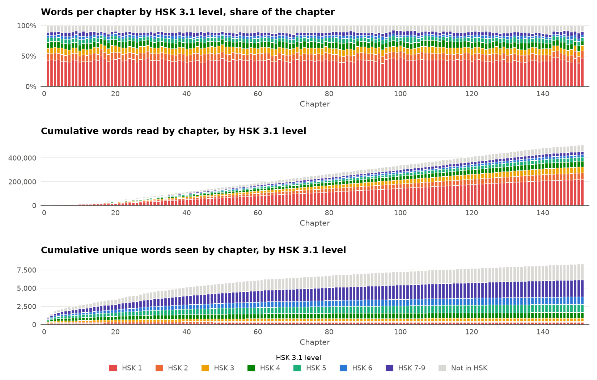
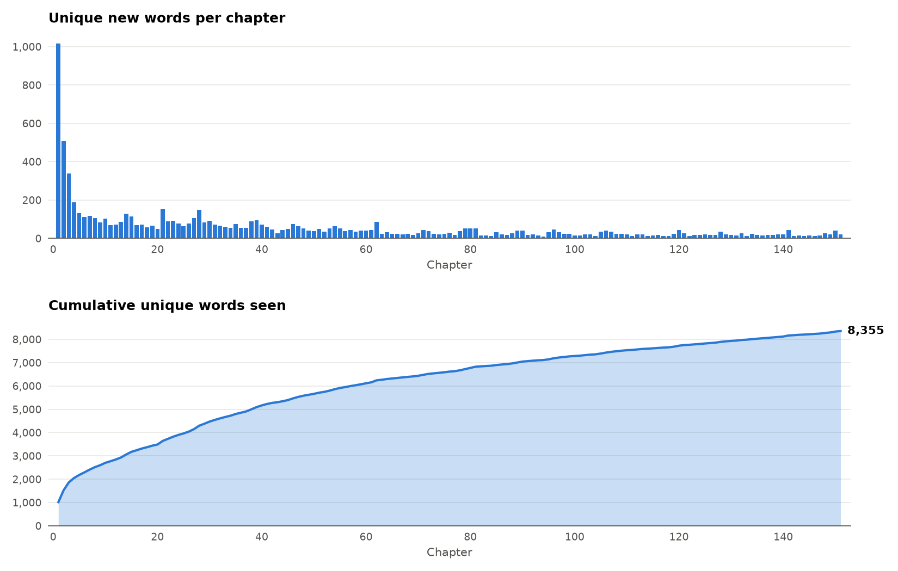
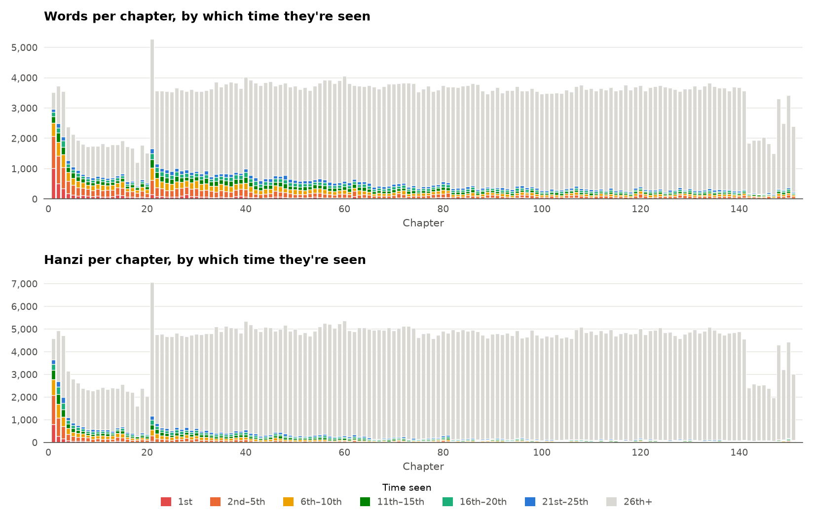
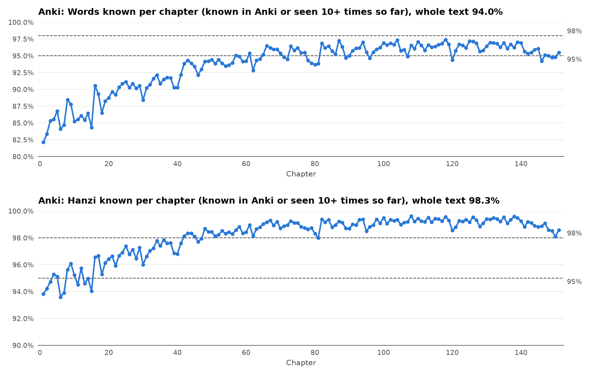
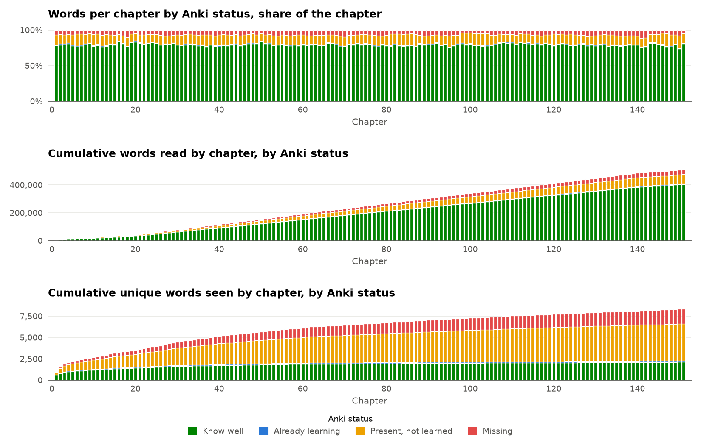

# Rabbit-Hole

Takes a Chinese `.txt` or `.epub`, segments it with HanLP, and tells you how
hard it is against the HSK 2.0, HSK 3.0 and HSK 3.1 word lists. It can also check
AnkiConnect to see how much of the text's vocabulary you already know, and
export the words you're missing to a plain text file that
[Carrot Chunker](https://github.com/Candice-Bennett/Carrot_Chunker) can turn
into Anki cards. 
If multiple texts are analysed Rabbit-Hole can even complete a meta-analysis!
Allowing it suggest a reading order as well as ranking each of the texts on all sorts of metrics.
The entry point is [main.py](main.py), and the pipeline
steps live under [src](src).

## What it does

- Loads the text (`.txt` or `.epub`) and cleans [Novel-Downloader](https://github.com/404-novel-project/novel-downloader) noise.
- Segments it with HanLP, counting how many times each word appears.
- Compares every word against HSK 2.0, HSK 3.0 and HSK 3.1 and charts the breakdown by
  level.
- Gives you an almost overwhelming amount of data about your text giving an analysis of words
  and hanzi both culumative and unique over the text of the book.
- If `anki_analysis` is on and AnkiConnect is configured, looks up each word against your Anki
  collection and charts the same breakdowns informed by your anki stats
- Offers to export the missing words to a text file, one line per word as
  `word<TAB>count<TAB>example sentence`, where `count` is how many times the
  word occurs in the text and the example is the first sentence the word
  occurs in that's between `example_sentence_min_hanzi` and
  `example_sentence_max_hanzi` hanzi long, falling back to the very first
  sentence the word appears in if none of its sentences fit that range.
  This can then be imported to [Carrot Chunker](https://github.com/Candice-Bennett/Carrot_Chunker) to make anki cards.
- If multiple texts are analysed with Rabbit-Hole (and it can do batch processing) Rabbit-Hole can complete a meta-analysis
  of all your texts ranking texts based on difficulty and even suggest a reading order of the texts!

This tool does not create Anki cards itself, it only measures difficulty and
tells you what you're missing. Feed the exported word list into
[Carrot Chunker](https://github.com/Candice-Bennett/Carrot_Chunker) to build the cards.

## Example charts

These are just five of the charts Rabbit-Hole makes, plus a meta-analysis reading order. A normal run writes many more to `output/`, 
covering new words and hanzi per chapter, cumulative reading, sentence and paragraph length,
HSK lists, and optional Anki and chengyu versions.

**Reading order (meta-analysis)** - when several books have been analysed, the suggested order to
read them in, starting from your Anki words and learning from each book as you go.
[Ranking your books](#ranking-your-books).





**Unique new words** - how many new words each chapter throws at you, and the
running total of unique words seen.



**Occurrences** - every word and hanzi in each chapter, coloured by which time
you're seeing it, so you can see how quickly new vocabulary turns into repeats.



**Known coverage (Anki)** - the share of each chapter you'd know, counting a
word or hanzi as known if you know it well in Anki or have already seen it 10
times earlier in the text, against 95% and 98% reading thresholds.



**Anki knowledge** - every word split by its status in your Anki collection:
each status's share of every chapter, then cumulative words read and cumulative
unique words seen.



## Prerequisites

- **Python** - get it from [python.org/downloads](https://www.python.org/downloads/). On Windows,
  tick "Add python.exe to PATH" during install, then confirm it worked with `python --version`
  in a new terminal.
- **AnkiConnect** (only needed for the Anki knowledge check) - in Anki go to Tools > Add-ons > Get Add-ons,
  paste in code `2055492159`, and restart Anki. More info at
  [ankiweb.net/shared/info/2055492159](https://ankiweb.net/shared/info/2055492159).

## Downloading Rabbit-Hole

Click the green "Code" button near the top of this page, then "Download ZIP",
and extract it somewhere.

You'll then need a terminal open *in that folder* to run the commands below. On Windows,
open the extracted folder in File Explorer, click the address bar, type `cmd`, and hit Enter.

## Running Rabbit-Hole

Drop your text (`.txt` or `.epub`) into [data](data), or set `input_path` in
[config.json](config.json).

```
pip install -r requirements.txt
python main.py [name of your file including extension (.txt/.epub)]
```

or, if `input_path` is set or `run_for_data_files` is `true` in [config.json](config.json):

```
pip install -r requirements.txt
python main.py
```

NOTE: first run downloads the HanLP model (network required, cached after in
`~/.hanlp`).

## Ranking your books

Every run saves a `summary.json` next to the book's charts. With `meta_analysis`
on Rabbit-Hole ranks every book that has a summary, and writes the results to
`output/meta-analysis/`:

- `reading_order.txt`: three suggested reading paths and an overall difficulty score.
  Every path starts from the words you already know (your well-known Anki words and
  any [books you've read](#books-youve-read)), and counts every word seen
  `seen_times_to_count_as_learned` times in a book as learned for the books after it.
  - The optimised path looks ahead for the order with the lowest average difficulty,
    so it will take a slightly harder book early if what it teaches makes the next
    few easier. It never picks a book more than `reading_path_tolerance` points
    harder than the easiest one on offer, and `reading_path_length_weight` counts
    longer books as slightly harder.
  - The word count adjusted path always picks the book whose first `opening_words`
    words you'd know the most of, so long books don't come first just because they
    repeat their words more.
  - The whole book path always picks the book you'd know the most of overall.
- `difficulty_lists.txt`: separate easiest-first lists for each measure: how much
  you'd know (first `opening_words` words and whole book), the HSK level needed for
  each of the `coverage_targets`,
  opening difficulty, new-word density, sentence length, chengyu density,
  vocabulary breadth and length.
- `books.csv`: every number for every book, for a spreadsheet.

To re-rank without re-analysing anything (e.g. after your Anki reviews have moved
on), run:

```
python rank.py
```

Books analysed before this feature existed have no summary, so run `main.py` on
them once to include them.

## Books you've read

Put books you've already read in [data/books_read](data/books_read) and turn on
`use_read_books`, and Rabbit-Hole will count their vocabulary as words you know,
alongside your Anki words. They're segmented once (and again only if the file or
`exclude_names` changes) and get no charts of their own.

`read_books_knowledge` sets how Rabbit-Hole works out which words from each book you
know. There are two options:

- `"seen_times"` - assumes you learned a word by meeting it often enough. Every word
  that appears at least `seen_times_to_count_as_learned` times in the book counts as
  known.
- `"percentage_understood"` - uses your own judgement of how well you followed the book,
  set with `read_books_percentage_understood`. Rabbit-Hole sorts the book's words from
  most to least common and counts words as known, starting from the top, until they
  make up that percentage of everything you read. For example `95` means "I understood
  95% of this book", so the most common words making up 95% of the text count as known
  and the rarest 5% don't.

`read_books_percentage_understood` can be one number for every book, or a list with one
value per book in alphabetical order, e.g. `[95, 80]` if you understood 95% of the first
book and 80% of the second. A list with fewer values than books stops with an error
listing the books in order. 

## Speeding up Rabbit-Hole

Most of a run is spent segmenting the text with HanLP, which runs on your CPU. These
options in [config.json](config.json) can make it noticeably quicker:

- `parallel_segmenting` - splits segmenting across two HanLP processes, each using half
  your CPU threads. In testing this made segmenting about 1.8x faster, 
  but it uses roughly twice the memory and takes a few seconds longer to start.
- `background_charts` - draws each book's charts in a separate process while the next
  book is segmented, so a multi-book run doesn't wait on the charts.
- `exclude_names` - the name tagger is roughly 40% of the segmenting time, so turning
  it off is a big speed-up, but people's names and place names will then be counted
  as vocabulary.
- `only_run_epub` / `only_run_txt` - if [data](data) holds both a `.epub` and a `.txt`
  of the same book, use one of these so each book is only analysed once.

The meta-analysis doesn't need HanLP at all, so you don't need to re-run `main.py` to
update it. `rank.py` re-ranks every analysed book from its saved `summary.json` in a few
seconds:

```
python rank.py
```

This picks up any change to your Anki reviews, `opening_words`, `ranking_hsk_version`,
`reading_path_tolerance`, `reading_path_length_weight`, `coverage_targets`,
`seen_times_to_count_as_learned` or the `read_books_` options. Changes to how the text
itself is read (`exclude_names`, `clean_text`, `clear_author_notes`) and new books in
[data/books_read](data/books_read) do need `main.py` to be run again.

## Config ([config.json](config.json))

| Flag | What it does |
|---|---|
| `meta_analysis` | after the run, rank every analysed book by difficulty and suggest a reading order (see [Ranking your books](#ranking-your-books)) |
| `opening_words` | how many words from the start of each book the ranking uses for its opening difficulty, new-word density and word count adjusted measures |
| `ranking_hsk_version` | which HSK list the ranking uses: `"2.0"`, `"3.0"` or `"3.1"` |
| `reading_path_tolerance` | for the optimised reading path, the most (in percentage points of the opening understood) a book can be harder than the easiest unread book at that point |
| `reading_path_length_weight` | how much harder the reading paths treat longer books: a book's difficulty is multiplied by its length divided by the median book length, to this power. e.g. `0.1` treats a book 4x the median length as about 15% harder and one a quarter of the median as about 13% easier, while `0.3` makes those about 52% harder and 34% easier. `0` ignores length |
| `seen_times_to_count_as_learned` | for the known coverage charts, once a word or hanzi has been seen this many times in the text, later appearances count as known `0` turns this off |
| `use_read_books` | count the vocabulary of the books in [data/books_read](data/books_read) as known (see [Books you've read](#books-youve-read)) |
| `read_books_knowledge` | how a book you've read adds known words: `"seen_times"` or `"percentage_understood"` |
| `read_books_percentage_understood` | with `"percentage_understood"`, how much of each book you understood, in percent. One number for every book, or a list with one value per book in alphabetical order |
| `anki_analysis` | run the Anki knowledge check, its charts and the missing-words export. |
| `mature_interval_days` | interval (in days) a card needs to count as "know well"  |
| `anki_fields` | `{note_type, field_name}` pairs telling it which Anki fields hold the Hanzi word, checked via AnkiConnect. Leave empty (`[]`) to skip the Anki check entirely. |
| `input_path` | `.txt` or `.epub` to read - `""` uses the command-line filename from [data](data) instead |
| `hsk_data_dir` | folder holding the HSK word lists |
| `missing_words_output` | where the missing-words export goes - `""` uses `output/<book name>/missing_words.txt`. Multi-book runs always use the book's own folder |
| `run_for_data_files` | run every file in [data](data) when no filename is given on the command line. `false` means you must pass one, i.e. `python main.py test.txt` |
| `only_run_for_missing_files` | with `run_for_data_files`, only run the files that don't have an `output/<book name>` folder yet, i.e. books added since the last run. A `.txt` and `.epub` of the same book share a folder, so once one has run the other is skipped |
| `only_run_epub` | with `run_for_data_files`, only run the `.epub` files. If `only_run_epub` and `only_run_txt` are both `true` or both `false`, every `.txt` and `.epub` is run. Also applies to [data/books_read](data/books_read) |
| `only_run_txt` | with `run_for_data_files`, only run the `.txt` files. Also applies to [data/books_read](data/books_read) |
| `use_chapters` | uses chapters for charts |
| `chart_bucket_words` | words per bar in the charts when `use_chapters` is `false` |
| `occurrence_bands` | colour bands for the occurrences charts, i.e. `[1, 5, 10, 15, 20]` colours the 1st time a word is seen, the 2nd-5th, 6th-10th, 11th-15th and 16th-20th differently. Occurrences past the last number go in a final band, i.e. 21st+  |
| `occurrence_overflow_band` | show the final band (i.e. 21st+) on the words and hanzi per chapter occurrences charts. |
| `coverage_targets` | dashed reference lines on the known coverage charts, in percent |
| `chengyu_analysis` | Makes graphs of all the chengyu (i.e. words with 4+ hanzi) |
| `chart_width_px` / `chart_height_px` | size of every chart image in pixels |
| `chart_x_limits` | `[min, max]` x range for every chart, in chapters (or words read when `use_chapters` is `false`), e.g. `[1, 50]` to show chapters 1-50. `null` shows all  |
| `chart_y_limits` | `[min, max]` y range per chart and panel, keyed by the chart's file name `null` shows all  |
| `example_sentence_min_hanzi` | shortest sentence (in hanzi) usable as an example |
| `example_sentence_max_hanzi` | longest sentence (in hanzi) usable as an example |
| `segment_batch_size` | sentences per HanLP call |
| `parallel_segmenting` | split segmenting across two HanLP processes, each using half your CPU threads. |
| `background_charts` | draw each book's charts in a separate process while the next book is segmented, so a multi-book run doesn't wait on the charts. Turn off to see chart errors straight away |
| `clean_text` | strip downloader noise  |
| `clear_author_notes` | when `clean_text` is on, also strip the author's notes |
| `exclude_names` | leave people's names and place names out of every count, chart and export, using HanLP's name tagger (downloads a second model on first run). |
| `ankiconnect_url` | the address AnkiConnect listens on |
| `ankiconnect_timeout` | seconds to wait for AnkiConnect to respond before giving up |

## Troubleshooting

- **HanLP's model download fails partway through**, with an error along the
  lines of `Chunk 1 downloaded size 197 mismatches with expected size ...`
  HanLP is used to identify the words so is essential. If you run into errors try running it again, if it keeps failing after a
    handful of retries then you can work around it by fetching the file yourself:
    1. Copy the URL from the `Downloading ...` line above the error.
    2. Download it in your browser and unzip it.
    3. Drop the resulting folder into the matching path under `~/.hanlp/` (on Windows this is usually `%APPDATA%\hanlp\`)
       (e.g. `~/.hanlp/tok/coarse_electra_small_20220616_012050/`),
       overwriting anything already there.
    4. Re-run it - it'll see the model's already in place and skip
       downloading it.

## Acknowledgements

The HSK word lists under [hsk_data](hsk_data) are sourced from
[More than enough Hanzi](https://github.com/becky82/mteh) by Rebecca J.
Stones, licensed under
[CC BY-SA 4.0](https://creativecommons.org/licenses/by-sa/4.0/).
THANK YOU SO MUCH FOR COLLATING THESE!
